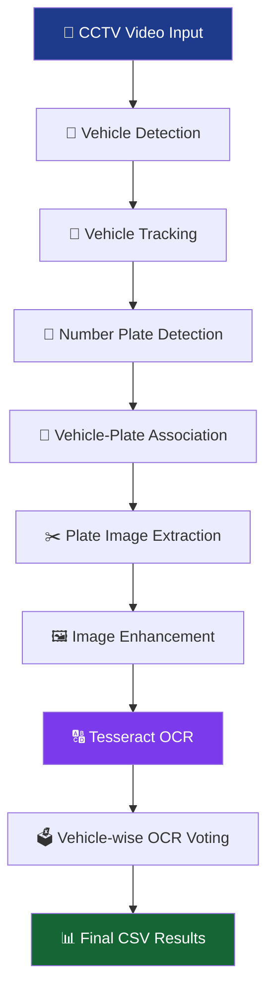

# 🚘 CCTV-Based Automatic Vehicle Number Plate Recognition

<p align="center">
  
  
  
  
  
</p>

<p align="center">
  <b>An AI-powered traffic surveillance system that detects vehicles, tracks their movement, identifies number plates, enhances plate images and extracts registration numbers automatically.</b>
</p>

---

## 🌟 Project Overview

This project implements an **Automatic Number Plate Recognition (ANPR)** system using Computer Vision, Deep Learning and Digital Image Processing.

The system analyses CCTV traffic footage to detect different types of vehicles, track them across video frames, locate their number plates and extract alphanumeric characters using Optical Character Recognition (OCR).

It combines multiple technologies into one automated pipeline to reduce the need for manual vehicle identification.

## 🎯 Key Features

| Feature | Description |
|:---|:---|
| 🚗 Vehicle Detection | Detects cars, motorcycles, buses and trucks |
| 🎯 Object Tracking | Tracks vehicles using ByteTrack with unique IDs |
| 🔍 Plate Detection | Detects and extracts vehicle number plates |
| 🔗 Vehicle Association | Connects number plates with tracked vehicle IDs |
| 🖼️ Image Enhancement | Improves plate visibility using image processing |
| 🔠 Text Recognition | Extracts registration characters using Tesseract OCR |
| 🗳️ OCR Voting | Groups repeated OCR readings by vehicle ID |
| 📊 Result Export | Saves detection and recognition results in CSV format |

## ⚙️ Technologies Used

<p align="center">
  
</p>

| Technology | Purpose |
|:---|:---|
| Python | Core programming language |
| YOLO11n | Vehicle detection |
| Ultralytics YOLO | Object detection and tracking framework |
| ByteTrack | Multi-object tracking |
| YOLOv8 License Plate Model | Number plate localisation |
| OpenCV | Image and video processing |
| CLAHE | Contrast enhancement |
| Tesseract OCR | Character recognition |
| NumPy | Numerical operations |
| Pandas | Data processing and CSV generation |

## 🧠 System Architecture

The project follows a modular computer vision pipeline.



### 🔄 How It Works

1. **Video Input:** CCTV footage is loaded using OpenCV.
2. **Vehicle Detection:** YOLO11n identifies vehicles in each frame.
3. **Vehicle Tracking:** ByteTrack assigns unique tracking IDs.
4. **Plate Detection:** A pretrained YOLO model detects number plates every fifth frame.
5. **Association:** Plate detections are associated with the corresponding tracked vehicle.
6. **Image Enhancement:** Cropped plate images undergo resizing, grayscale conversion, filtering and CLAHE.
7. **OCR Processing:** Tesseract extracts alphanumeric characters.
8. **Voting Mechanism:** Repeated OCR readings are grouped by vehicle ID to select the most frequent complete reading.
9. **Result Generation:** Final information is exported into CSV files.

## 🖼️ Image Processing Pipeline

The extracted number plate images undergo multiple enhancement operations.

| Processing Stage | Technique |
|:---|:---|
| 1️⃣ | Original plate extraction |
| 2️⃣ | Image resizing using bicubic interpolation |
| 3️⃣ | Grayscale conversion |
| 4️⃣ | Bilateral filtering |
| 5️⃣ | CLAHE contrast enhancement |
| 6️⃣ | Otsu and adaptive thresholding |
| 7️⃣ | OCR character extraction |

The objective is to improve character visibility and provide better input for OCR recognition.

## 📂 Project Structure

```text
license-plate-detection/
│
├── 📁 input/
│   └── README.txt
│
├── 📁 models/
│   ├── best.pt
│   └── README.txt
│
├── 📁 output/
│   ├── 📁 plates/
│   ├── 📁 enhanced/
│   ├── 📁 comparison/
│   ├── 📁 ocr_tests/
│   ├── plate_vehicle_data.csv
│   └── vehicle_ocr_results.csv
│
├── 📁 src/
│   ├── vehicle_detector.py
│   ├── vehicle_tracking.py
│   ├── plate_detector.py
│   ├── plate_vehicle_association.py
│   ├── enhance.py
│   ├── ocr.py
│   └── voting.py
│
├── 📄 main.py
├── 📄 requirements.txt
├── 📄 README.md
└── 📄 .gitignore
```

*Note: Update the tree if your final local filenames differ. Model weights, input videos and generated output files are not required to be committed.*

## 📊 Experimental Results

The system was tested using externally sourced CCTV traffic footage.

### Dataset Information

| Parameter | Value |
|:---|:---|
| Dataset Type | CCTV Traffic Video |
| Video Resolution | 1920 × 1080 (Full HD) |
| Vehicle Categories | Cars, Motorcycles, Buses, Trucks |
| Plate Processing | Every 5th frame |
| Vehicle Tracking | ByteTrack |

**Dataset Source:** [YouTube – CCTV Traffic Footage](https://www.youtube.com/watch?v=Gr0HpDM8Ki8)

### 📈 Observed Results

| Metric | Result |
|:---|---:|
| Total Plate Detections | **188** |
| Unique Vehicle IDs | **7** |
| Unique Frames with Plate Detections | **148** |
| UNKNOWN Associations | **0** |
| Average Plate Detection Confidence | **71.62%** |
| OCR Readings Used | **132** |
| Matching OCR Readings | **67** |
| OCR Voting Consistency | **50.76%** |

### 📌 Result Interpretation

The system successfully detected number plates and associated the saved detections with tracked vehicle IDs.

The OCR module produced varying recognition results depending on plate visibility, image quality and character appearance.

The 50.76% voting consistency represents agreement among OCR readings, not verified recognition accuracy.

## ⚠️ Current Limitations

- Incorrect character recognition under poor image conditions.
- Sensitivity to low-resolution and noisy plate images.
- Difficulty recognising different regional number plate formats.
- Potential tracking ID changes when vehicles disappear and reappear.
- No ground-truth-based accuracy evaluation has been performed yet.

## 🚀 Future Improvements

- [ ] Implement advanced deep learning-based OCR.
- [ ] Improve character recognition for different regional number plates.
- [ ] Introduce image super-resolution and perspective correction.
- [ ] Improve vehicle and plate association.
- [ ] Develop a real-time CCTV monitoring interface.
- [ ] Build an interactive web dashboard.
- [ ] Add database integration for storing vehicle records.
- [ ] Evaluate performance using labelled benchmark datasets.

## 💻 Installation and Setup

### 1. Clone the Repository

```bash
git clone https://github.com/YOUR_USERNAME/license-plate-detection.git
cd license-plate-detection
```

### 2. Create a Virtual Environment

```bash
python -m venv venv
```

### 3. Activate the Environment

**Windows CMD:**

```bash
venv\Scripts\activate.bat
```

### 4. Install Dependencies

```bash
pip install -r requirements.txt
```

### 5. Install Tesseract OCR

Install the Tesseract OCR application separately for Windows.

Configure the executable path in the OCR Python file:

```python
pytesseract.pytesseract.tesseract_cmd = (
    r"C:\Program Files\Tesseract-OCR\tesseract.exe"
)
```

### 6. Configure the Input Video

Place your CCTV video inside:

```text
input/cctv.mp4
```

### 7. Configure the License Plate Model

Place the pretrained license plate model at:

```text
models/best.pt
```

Model source:

[Koushim – YOLOv8 License Plate Detection](https://huggingface.co/Koushim/yolov8-license-plate-detection)

The YOLO11n vehicle detection weights are downloaded automatically by Ultralytics when required.

### 8. Run the Project

```bash
python main.py
```

Make sure your input video, model weights and Tesseract executable are configured correctly before running.

## 📚 References

1. Shashirangana et al., "Automated License Plate Recognition: A Survey on Methods and Techniques," IEEE Access, 2021.
2. Zhang et al., "ByteTrack: Multi-Object Tracking by Associating Every Detection Box," ECCV, 2022.
3. [Ultralytics YOLO Documentation](https://docs.ultralytics.com/)
4. [OpenCV Documentation](https://docs.opencv.org/)
5. [Tesseract OCR Documentation](https://tesseract-ocr.github.io/)

## 👨‍💻 Author

<p align="center">
  <b>Deehan Paul</b><br/>
  B.Tech – Computer Science and Engineering (AI & ML)<br/>
  KIIT University
</p>

<p align="center">
  <a href="https://github.com/Deehan123">
    
  </a>
</p>

---

<p align="center">
  ⭐ If you find this project interesting, consider giving it a star!
  <br/>
  <b>Built with Python, Computer Vision and a passion for solving real-world problems.</b>
</p>
